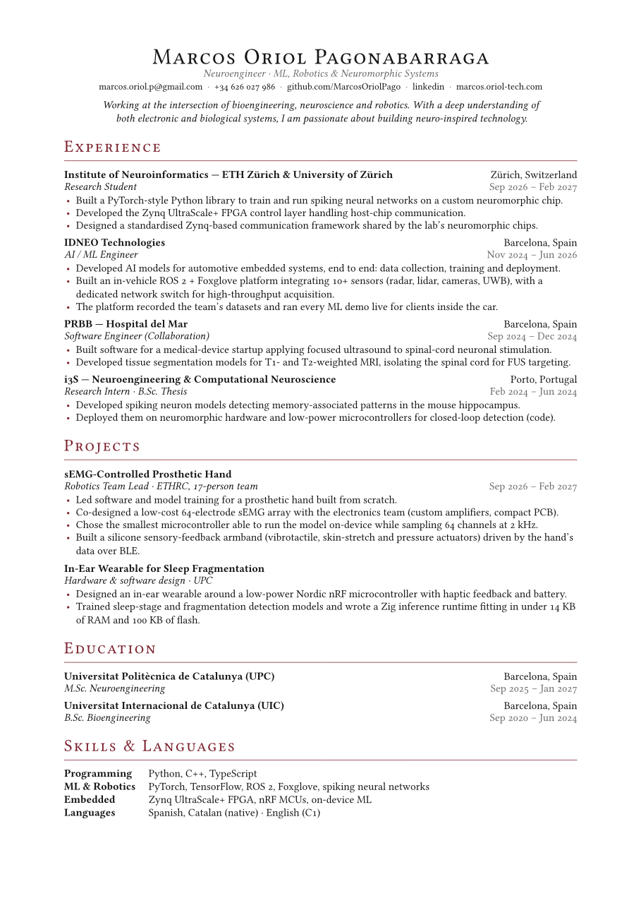

# Typst CV

A minimal, single-column CV in [Typst](https://typst.app) — classic serif typography,
no photo, no banner, built around projects and experience. A4, flows onto a second
page cleanly when needed (entries never split across pages, section titles never
end up orphaned at the bottom).



## Build

```bash
# install Typst once: cargo install --locked typst-cli   (or: snap install typst, brew install typst)
make          # → cv.pdf + preview.png
make watch    # rebuild on every save
```

## Layout

```
cv.typ              ← personal info + which sections appear, in which order
lib/cv.typ          ← all styling and components (template)
sections/*.typ      ← the content, one file per section
fonts/              ← optional extra fonts (e.g. EB Garamond)
```

## Components

```typst
= Projects                                   // section title

#project("Name", url: "github.com/u/repo",
  tagline: "One-line description",
  stack: ("Python", "PyTorch"))[
  Free text or a bullet list.
]

#entry(org: "Company", location: "City",
  title: "Role", date: "2024 – Present")[
  - Achievement
]

#skills(("Label", "values"), ("Other", "values"))
#summary[Short profile paragraph.]
```

Template options (in `cv.typ`): `name`, `tagline`, `contacts`, `show-name`, `font`,
`font-size`, `accent`, `margin`, `lang`.

## License

MIT
